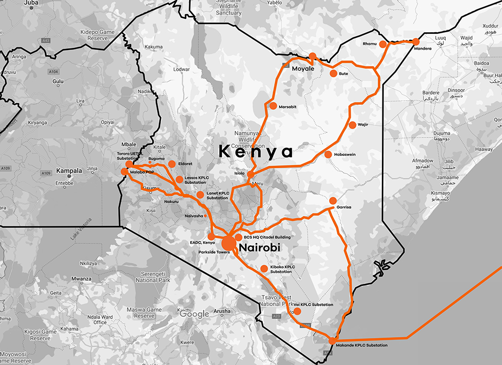

# BCS Kenya

The BCS Kenya map is a hand-coded, rough approximation of the network map available on their [website](https://www.bcs-ea.com/bcs-our-network-kenya.html). Archived version of the network map [here](https://web.archive.org/web/20251223184843/https://www.bcs-ea.com/bcs-our-network-kenya.html). It is intended for demonstration purposes only.

-Steve Song, Nov 2026